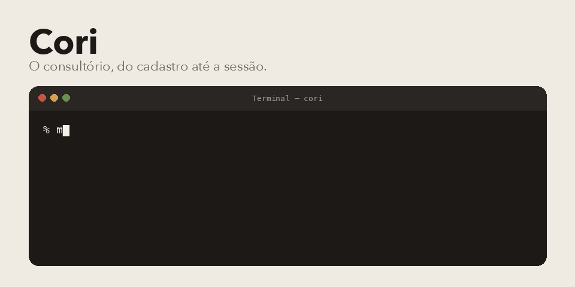
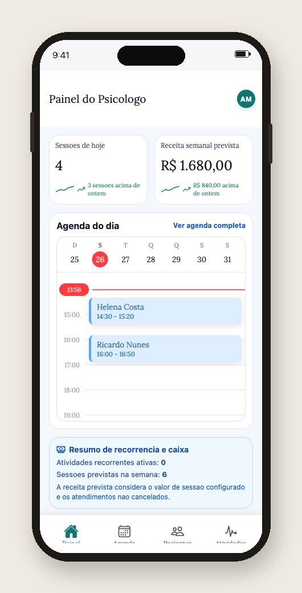

<p align="center">
  
</p>

## A tela

App de iPhone. O login já vem com a conta de exemplo, `dr.aurora@cori.dev`. O painel abaixo é a sessão do psicólogo, com a agenda do dia preenchida.

<p align="center">
  
</p>

Cori é o sistema do consultório de psicologia. Clínica, paciente, triagem, agenda, atividade e formulário no mesmo lugar. Cada consultório fica isolado do outro.

## Do que é feito

Backend em Python 3.12: FastAPI, SQLAlchemy, Alembic, PostgreSQL 17 e Redis. O worker roda ao lado da API. O app é Expo, em `front-end/`, com React Native, Expo Router e Reanimated.

O que já tem rota de verdade: autenticação, perfil da clínica, triagem, pacientes, sessões, atividades, formulários, notificações e o painel.

## Subir

```bash
make bootstrap
```

Isso prepara o `.env`, instala dependência e sobe a stack. A API fica na porta 8000. `GET /health` devolve o estado do Postgres e do Redis.

```bash
make health
make down
make pipeline
```

No simulador do iPhone, com o backend no ar:

```bash
make run-ios
```

Dá para trocar o aparelho: `make run-ios IOS_DEVICE="iPhone 16"`.

## Onde mexer

- `backend/app/api/` são as rotas.
- `backend/alembic/versions/` é o histórico do banco, inclusive o isolamento por consultório.
- `front-end/` é o app.
- `infra/docker-compose.yml` é o Postgres, o Redis, a API e o worker.

Pedro Américo Paletot, [peamericoo](https://github.com/peamericoo).
